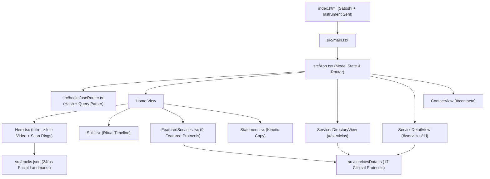
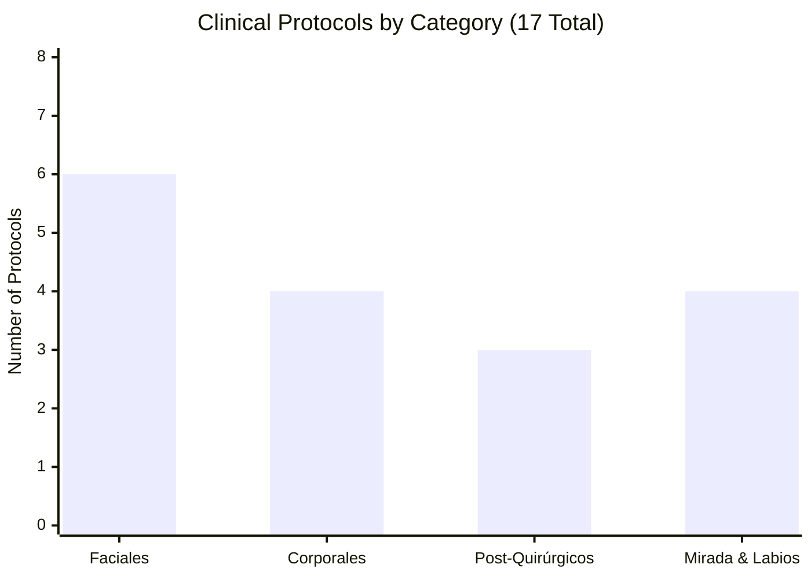

# MM Centro Estético — Mónica Mejía

> Web platform for **MM Centro Estético** in Cuenca, Ecuador. Features a 4-model interactive AI facial-diagnostic hero stage, seamless intro-to-idle video choreography, 17 clinical aesthetic protocols, and direct WhatsApp consultation booking.


---

## Key Features

- **4-Model Interactive Hero Stage (`Hero.tsx`)**: Cycles across 4 clinical personas (**Sofía**, **Valentina**, **Camila**, **Isabela**) with real-time MediaPipe-tracked facial scan rings, live diagnostic telemetry cards, and seamless intro → idle video handoffs.
- **17 Clinical Protocols (`servicesData.ts`)**: Categorized across **Faciales**, **Corporales**, **Post-Quirúrgicos**, and **Mirada & Labios**, with instant search, category filtering (`#/servicios?categoria=...`), quick-view modals, and dedicated protocol detail pages (`#/servicios/:id`).
- **Editorial Storytelling (`Split.tsx`, `Statement.tsx`)**: Scroll-linked Lenis + `requestAnimationFrame` choreography, reduced-motion support (`useReducedMotion`), and two-font editorial typography (`Satoshi` + `Instrument Serif`).
- **Cuenca Clinic & GPS Integration (`ContactView.tsx`, `Footer.tsx`)**: Interactive Google Maps embed, clinic space showcase, and pre-filled WhatsApp consultation builder.

---

## Visual Showcase

| Sofía (Max Light) | Isabela (Integral & Lipo) | Clinic Space |
| :---: | :---: | :---: |
|  |  |  |

---

## System Architecture



---

## Service Catalog Distribution



---

## Tech Stack

| Layer | Technology |
| :--- | :--- |
| Framework | React 19 + TypeScript 5.8 |
| Build Tool | Vite 6 |
| Styling | Tailwind CSS v4 (`@tailwindcss/vite`) |
| Smooth Scroll | Lenis |
| Media & Tracking | FFmpeg, OpenCV, MediaPipe FaceLandmarker (`scripts/`) |

---

## Getting Started

```bash
# Install dependencies
npm install

# Start development server (http://localhost:5173/)
npm run dev

# Typecheck
npm run lint

# Production build
npm run build
```

---

## Documentation

- [Product Requirements Document (PRD)](docs/PRD.md)
- [LLM Context Index (`llms.txt`)](llms.txt)
