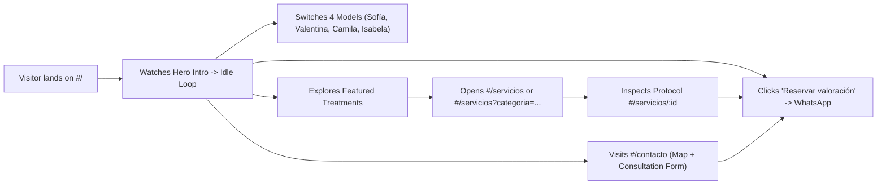

# Product Requirements Document (PRD) — MM Centro Estético

**Product:** MM Centro Estético Web Platform  
**Location:** Cuenca, Ecuador  
**Director:** Mónica Mejía  

---

## 1. Executive Summary

The MM Centro Estético web platform positions the clinic as a precision aesthetic medicine studio in Cuenca, combining editorial luxury with interactive AI-inspired facial diagnostic storytelling and frictionless WhatsApp booking.

---

## 2. User Flows

---

## 3. Functional Requirements

| ID | Feature | Description | Status |
| :--- | :--- | :--- | :--- |
| FR-01 | 4-Model Hero Stage | Seamless intro-to-idle video playback with 24fps tracked facial scan rings | Implemented |
| FR-02 | Hash + Query Router | Supports `#/`, `#/servicios`, `#/servicios?categoria=...`, `#/servicios/:id`, `#/contacto`, and home anchors | Implemented |
| FR-03 | Clinical Catalog | 17 protocols across 4 categories with live search, category filter, and quick-view | Implemented |
| FR-04 | Booking & Maps | Pre-filled WhatsApp deep links and embedded Google Maps for Cuenca clinic | Implemented |
| FR-05 | Accessibility & Motion | Honors `prefers-reduced-motion`, semantic landmarks, and `>= 13px` above-the-fold typography | Implemented |

---

## 4. Non-Functional Requirements

- **Typography:** Strictly 2 font families (`Satoshi` + `Instrument Serif`) with `tabular-nums` for telemetry counters.
- **Performance:** Static asset preloading (`hero-poster.webp`), lazy-loaded below-the-fold images, and `0` horizontal overflow across `390x844` mobile and `1440x900` desktop.
- **Media Pipeline:** 24fps H.264 `yuv420p` video assets with closed GOP idle loops (`public/media/model*-idle.mp4`).
